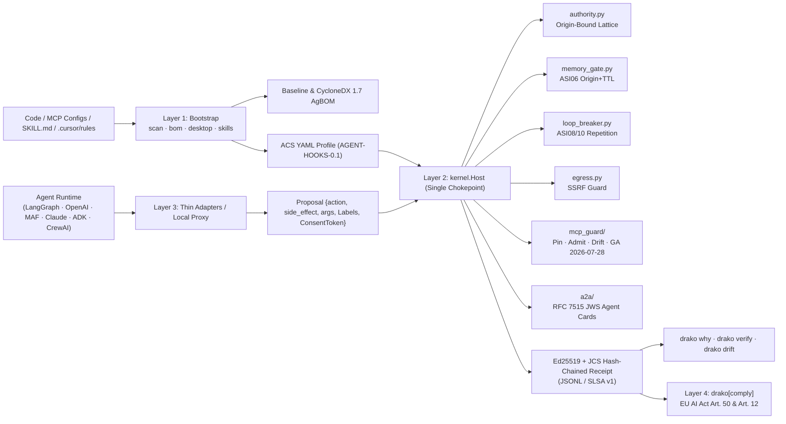

# Drako v4 Architecture — The Portable Authority Kernel

Drako v4.0 is a **100% local-first, zero-backend, deterministic security architecture** organized into four orthogonal layers with a single runtime chokepoint. All architectural decisions are recorded in [`docs/adr/`](adr/README.md).

## Four-Layer System Design

### Layer 1 — Static Bootstrap (`cli/`, `desktop/`, `ts_parser/`, `heuristic_reachability.py`)
- Discovers agents, tools, models, MCP servers, and coding-agent instruction files offline.
- Evaluates **82 unique static AST rules (99 Python + TypeScript checks)** and **5 instruction/skill poisoning rules (`INST-001..005`)**.
- Generates `.drako/.last_scan.json` baselines and **CycloneDX 1.7** BOMs to bootstrap runtime policies.

### Layer 2 — Authority Kernel (`src/drako/kernel/`)
- **`envelope.py` & `host.py`:** Single fail-closed evaluation chokepoint (`Proposal -> Guardian -> Decision -> Receipt`).
- **`authority.py`:** Origin-bound trust lattice (`tool:* <= TOOL`, `memory:* <= AGENT`, `ctk:* <= UNTRUSTED`), `OriginAttester`, and operator-signed Ed25519 `ConsentToken`s.
- **`memory_gate.py`:** Dedicated `memory_write` gate requiring origin, bounded TTL, and `>= AGENT` trust (`ASI06`).
- **`receipts.py`:** Ed25519 (RFC 8032) + JCS (RFC 8785) hash-chained receipts, in-toto/SLSA v1 export, provenance subgraph builder, and Q1 HMAC `"telemetry"` grader.
- **`drift.py`:** MITRE ATLAS v2026.08 scope-drift detector (`uncovered`, `widened`, `flipped`, `stale`).
- **`loop_breaker.py` & `egress.py`:** Thread-safe repetition breaker (`ASI08`/`ASI10`) and fail-closed SSRF egress guard.
- **`ctk_host.py`:** `AGENT-HOOKS-0.1` conformance harness (44/44 applicable passing).

### Layer 3 — Protocol Guards & Unified Offline Adapters (`mcp_guard/`, `a2a/`, `adapters/`, `proxy/`)
- **`mcp_guard/`:** `mcp.lock` SHA-512 pinning, admission, runtime `tools/list` drift (*Deadbugz*), CycloneDX 1.7 AgBOM, and stateless `MCPGAClient` (`2026-07-28` GA).
- **`a2a/`:** A2A v1.0 Signed Agent Cards using RFC 7515 Detached JWS (`EdDSA`) + RFC 8785 JCS.
- **`adapters/`:** Thin offline translators over `Host` enforcing T-5 re-govern-after-modify for LangGraph, OpenAI Agents SDK, Microsoft Agent Framework, Claude Agent SDK, Google ADK, and CrewAI.
- **`proxy/`:** Optional loopback (`127.0.0.1`) HTTP proxy wired to `LoopBreaker`, `egress`, and `Host`.

### Layer 4 — Compliance Evidence (`comply/`, optional extra `drako[comply]`)
- Generates EU AI Act compliance dossiers aligned with the **Digital Omnibus on AI** (Art. 50 Aug/Dec 2026; Annex III High-Risk Dec 2027; Annex I Aug 2028) consuming local Ed25519 receipt chains for Art. 12 evidence.
